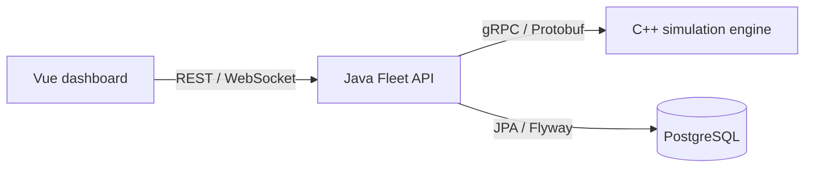

# Autonomous Robot Fleet Simulator

Phase 1 is a local warehouse digital twin. Inspect three stationary robots in a 3D warehouse, select them in the viewport or inspector, and refresh the snapshot from the C++ simulation engine.

## Architecture



The browser connects through the dashboard's same-origin proxy. The C++ engine owns the warehouse grid and robot state. Read [the architecture notes](docs/architecture.md) for service boundaries, coordinate conventions, and failure behavior.

| Location | Stack |
| --- | --- |
| `apps/dashboard` | Vue 3, TypeScript, Vite, Vue Router, Pinia, Tailwind CSS, Three.js, TresJS, ESLint, Prettier, Vitest, Vue Test Utils |
| `services/fleet-api` | Java 21, Spring Boot 3.5, Maven Wrapper, Web, WebSocket, JPA, Flyway, PostgreSQL, grpc-java, JUnit 5 |
| `services/simulation-engine` | C++20, CMake, gRPC, Protocol Buffers, GoogleTest |
| `proto` | Shared Protobuf schema, generated by Maven and CMake |
| `docs` | Architecture and implementation conventions |
| `docker-compose.yml`, `.env.example` | Local multi-service setup and environment settings |

## Run with Docker

Install and start Docker Desktop with Docker Compose v2 or newer. The images used by Compose have ARM64 variants. Docker builds the dashboard and both backends and runs their tests.

```sh
cp .env.example .env
docker compose up --build
```

Open [the dashboard](http://localhost:5173). The API is available at [port 8080](http://localhost:8080/api/health), gRPC at port 50051, and PostgreSQL at port 5432. Host ports are bound to loopback by default. Use unique credentials for any shared environment.

```sh
docker compose config --quiet
docker compose ps
curl -fsS http://localhost:8080/api/health
curl -fsS http://localhost:8080/api/robots
curl -fsS http://localhost:8080/api/simulation/status
docker compose exec simulation-engine simulation-engine --health-check
docker compose down
```

If a host port is in use, set its corresponding host-port variable in `.env` and use the new port in direct calls. The container ports and dashboard proxy stay the same.

Compose keeps PostgreSQL data in the `fleet-postgres` volume. PostgreSQL only uses the initialization variables when creating a fresh data directory.

## Local development

Prerequisites are Node.js 22.12+ on the Node 22 line or Node 24+, npm, Java 21, CMake 3.22+, a C++20 compiler, gRPC and Protobuf development packages with their compiler tools, GoogleTest, and a running PostgreSQL 17 instance. The first npm and Maven runs need registry access. On Apple Silicon, a native ARM64 Homebrew setup can supply `cmake`, `grpc`, `protobuf`, and `googletest`. Use dependencies from the same package manager so C++ generated code uses the matching Protobuf runtime.

Start PostgreSQL using `docker compose up -d postgres` or configure the API for an existing local database. Run the services from separate terminals.

**Simulation engine**

```sh
cmake -S services/simulation-engine -B services/simulation-engine/build
cmake --build services/simulation-engine/build --parallel
services/simulation-engine/build/simulation-engine
```

If CMake needs the Homebrew package search path, add `-DCMAKE_PREFIX_PATH="$(brew --prefix)"` to the first command.

**Fleet API**

```sh
cd services/fleet-api
./mvnw spring-boot:run
```

Set `JAVA_HOME` to a Java 21 installation as needed. Flyway applies migrations during startup, then Hibernate validates the mapped schema. Export any custom PostgreSQL and engine settings in this terminal. Compose reads the root `.env` separately.

**Dashboard**

```sh
cd apps/dashboard
npm ci
npm run dev
```

Vite proxies API and WebSocket requests to `http://localhost:8080` by default. Set `DASHBOARD_API_TARGET` for a different address.

## Environment settings

| Variable | Default | Purpose |
| --- | --- | --- |
| `POSTGRES_DB`, `POSTGRES_USER`, `POSTGRES_PASSWORD` | `fleet`, `fleet`, `fleet-local` | Database and local development credentials |
| `POSTGRES_HOST_PORT`, `SIMULATION_HOST_PORT`, `API_HOST_PORT`, `DASHBOARD_HOST_PORT` | `5432`, `50051`, `8080`, `5173` | Compose host ports |
| `DB_HOST`, `DB_PORT` | `localhost`, `5432` | API database address, with host set to `postgres` in Compose |
| `SIMULATION_HOST`, `SIMULATION_PORT` | `localhost`, `50051` | API gRPC destination, with host set to `simulation-engine` in Compose. The engine also reads its port from `SIMULATION_PORT`. |
| `SIMULATION_BIND_HOST` | `127.0.0.1` | Engine bind address, set to `0.0.0.0` in the image |
| `SIMULATION_DEADLINE_MS` | `1500` | Per-call Java gRPC deadline |
| `SERVER_PORT` | `8080` | Standalone Spring HTTP port |
| `CORS_ORIGINS` | Local dashboard origins | Comma-separated browser origins for REST and WebSocket |
| `DASHBOARD_API_TARGET` | `http://localhost:8080` | Vite development proxy target |

## API

| Endpoint | Response |
| --- | --- |
| `GET /api/health` | HTTP 200 with `apiOperational` and `simulationReachable` booleans. The API remains available during an engine outage. |
| `GET /api/robots` | Array of robots with `id`, `position: {x, y}`, `headingDegrees`, `batteryPercent`, and `status`. |
| `GET /api/simulation/status` | `tick`, `running`, `gridWidth`, and `gridHeight`. |
| `GET /ws/simulation` (WebSocket upgrade) | Accepts a connection for future event streaming. |

Robot and simulation status requests return HTTP 503 when the upstream gRPC request fails.

## Build and test

```sh
(cd apps/dashboard && npm ci && npm test && npm run lint && npm run build)
(cd services/fleet-api && ./mvnw package)
cmake -S services/simulation-engine -B services/simulation-engine/build
cmake --build services/simulation-engine/build --parallel
ctest --test-dir services/simulation-engine/build --output-on-failure
```

## Compatibility

TresJS 4 and Cientos 4 are paired with Three.js r179 and its matching types. The npm lockfile pins direct and transitive dependencies. Spring Boot 3.5 runs on Java 21, and Maven chooses the ARM64 or x86-64 generators for its host. CMake generates C++ bindings with the same package set used to link the server. The Java and C++ runtime versions can differ because communication uses the shared proto3 wire schema. Debian Bookworm supplies the C++ gRPC and Protobuf pair in Docker.

## Phase 1 limits and roadmap

The engine publishes a stationary snapshot at tick zero. The dashboard provides snapshot refresh and camera controls. WebSockets accept connections and have no event stream yet. Robots, Tasks, Analytics, and Settings are placeholder routes. The database has a task schema foundation, with no task scheduling workflow in this phase.

Future phases can introduce the tick loop and simulation controls, streamed updates, warehouse obstacle validation and pathfinding, collision avoidance, battery use, and task assignment.
